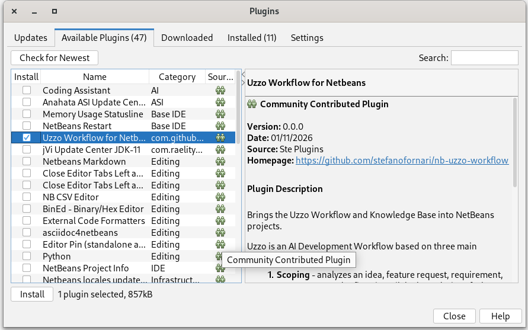
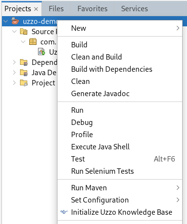
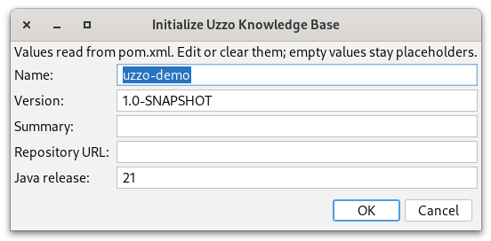
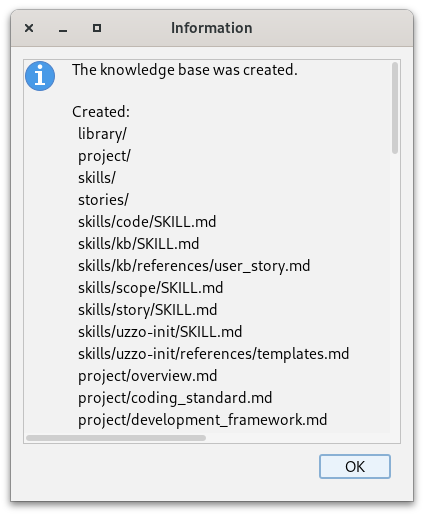
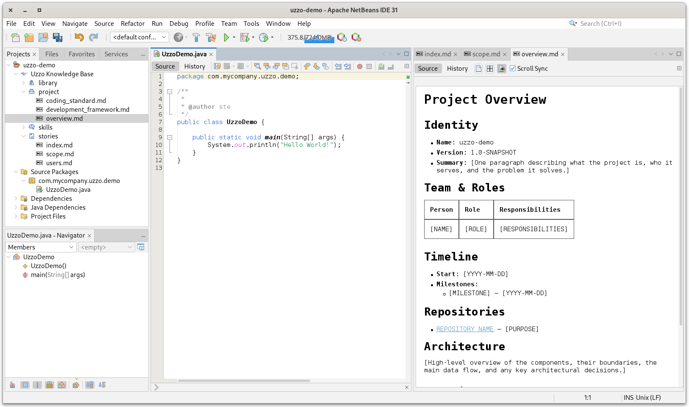

# Instructions: from download to your first knowledge base

This walkthrough takes you from downloading the plugin to a dummy project that
has an Uzzo Knowledge Base (KB) in it. It takes about ten minutes.

1. TOC
{:toc}

## Prerequisites

- Apache NetBeans 28, the version the plugin is built against
- JDK 21 or later
- Maven (the Maven bundled with NetBeans is fine)

> Confirm the minimum JDK. The plugin is compiled for Java 21, while the README
> says JDK 17+.
{: .todo }

## 1. Install the plugin in NetBeans

1. In NetBeans, open **Tools → Plugins**.
2. Select the **Available Plugins** tab and select **Uzzo Workflow for NetBeans**.
3. Click **Install**.
4. Follow the installer: accept the license and, if prompted, trust the unsigned
   plugin.
5. Restart NetBeans if asked.



## 1. Create a dummy project

You only need a project to hold the knowledge base. The initialization action is
available on Maven projects, so create a small one.

1. Choose **File → New Project...**.
2. Select **Java with Maven → Java Application** and click **Next**.
3. Name it `uzzo-demo`, pick a location, and keep the default Group Id and
   Version. Click **Finish**.
4. The project appears in the **Projects** window.

## 4. Initialize the knowledge base

1. Right-click the `uzzo-demo` project and choose **Initialize Uzzo Knowledge
   Base**.
2. A dialog proposes the project facts it read from your `pom.xml`: **Name**,
   **Version**, **Summary**, **Repository URL** and **Java release**. Edit them,
   or clear any you don't know yet: empty values stay as placeholders.
3. Click **OK**. The knowledge base is created in the background, and a report
   lists what was created, skipped, left as placeholders or found incomplete.

Initialization is additive: it never overwrites or deletes existing files, so it
is safe to run on a project that already has some content.

 
`

## 5. Explore the knowledge base

The project now has a top-level `uzz/` folder with four directories:

```
uzz/
├── library/
├── project/
├── skills/
└── stories/
```

In the **Projects** window, the folder shows as the **Uzzo Knowledge Base** node,
with an Aladdin's lamp icon, just above the source folders. Expand it to browse
the seeded workflow skills and articles.

Open a document, for example one under `project/`. It opens in a separate editor
deck on the right of the IDE, so the knowledge base stays next to your code.
Values the initializer could not know are bracketed placeholders such as
`[PROJECT NAME]`: replace them as you go.



## Keeping it in sync

- If files change outside the IDE, for example when an AI agent writes to the
  knowledge base, expand a folder or run **Refresh Knowledge Base** to see them.
- If the structure is incomplete, right-click the project and choose **Repair
  Uzzo Knowledge Base**. Once a knowledge base exists, this replaces the
  *Initialize* entry. Existing content is left untouched.

## What's next

Read how the workflow works on the
[Uzzo Workflow site](https://stefanofornari.github.io/uzzo-workflow/): the
[scoping phase](https://stefanofornari.github.io/uzzo-workflow/workflow/scoping)
and the [knowledge base](https://stefanofornari.github.io/uzzo-workflow/knowledge-base)
conventions.
